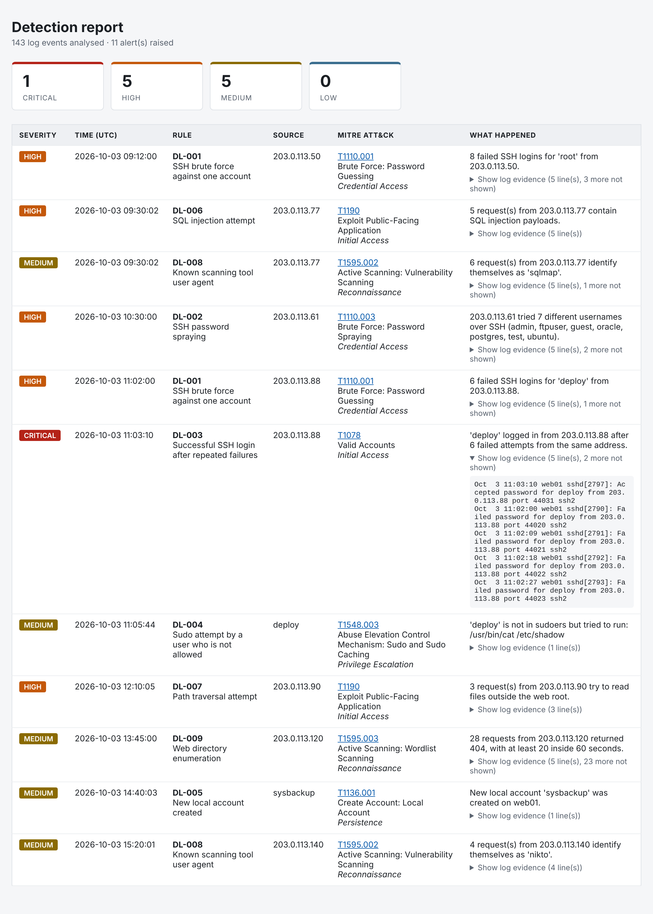

# 🛡️ SOC Detection Lab — Log Analysis & Threat Detection


A Python tool that reads SSH and web server logs, runs nine detection rules mapped to MITRE ATT&CK, and produces an alert report an analyst can triage. It is the kind of work a SOC analyst does every day: turn raw logs into events, decide what is suspicious, and explain why.



## ✨ What it does

1. **Parses the logs** — reads Linux `auth.log` (SSH, sudo, new accounts) and Apache/Nginx access logs into structured events.
2. **Runs the detections** — nine rules covering brute force, password spraying, account compromise, privilege escalation, persistence, web attacks and scanning.
3. **Maps each alert to MITRE ATT&CK** — every alert carries the technique ID, name and tactic.
4. **Reports the results** — prints the alerts, saves them as JSON (for a SIEM or ticketing system) and writes an HTML report with the log lines that triggered each alert.

## 🔍 Detection rules

| ID | Detection | Log | Severity | MITRE ATT&CK |
|---|---|---|---|---|
| DL-001 | SSH brute force against one account (5 failures in 2 minutes) | auth | High | [T1110.001](https://attack.mitre.org/techniques/T1110/001/) Password Guessing |
| DL-002 | SSH password spraying (5 usernames from one IP in 10 minutes) | auth | High | [T1110.003](https://attack.mitre.org/techniques/T1110/003/) Password Spraying |
| DL-003 | Successful SSH login straight after repeated failures | auth | Critical | [T1078](https://attack.mitre.org/techniques/T1078/) Valid Accounts |
| DL-004 | Sudo attempt by a user who is not in sudoers | auth | Medium | [T1548.003](https://attack.mitre.org/techniques/T1548/003/) Sudo and Sudo Caching |
| DL-005 | New local account created | auth | Medium | [T1136.001](https://attack.mitre.org/techniques/T1136/001/) Local Account |
| DL-006 | SQL injection payload in a URL | web | High | [T1190](https://attack.mitre.org/techniques/T1190/) Exploit Public-Facing Application |
| DL-007 | Path traversal attempt | web | High | [T1190](https://attack.mitre.org/techniques/T1190/) Exploit Public-Facing Application |
| DL-008 | Known scanning tool user agent (sqlmap, Nikto and others) | web | Medium | [T1595.002](https://attack.mitre.org/techniques/T1595/002/) Vulnerability Scanning |
| DL-009 | Web directory enumeration (20 "not found" replies in 60 seconds) | web | Medium | [T1595.003](https://attack.mitre.org/techniques/T1595/003/) Wordlist Scanning |

The thresholds are constants at the top of `detectlab/rules.py`, so they are easy to tune.

## 🛠️ Tech stack

- **Language:** Python 3 (standard library only, nothing to install)
- **Framework:** MITRE ATT&CK for technique mapping
- **Testing:** unittest, run automatically by GitHub Actions on every push
- **SIEM:** each rule is also written as a Splunk search in [`queries/splunk.md`](queries/splunk.md)

## 📁 Project structure

```
soc-detection-lab/
├── detect.py                  command-line entry point
├── detectlab/
│   ├── parsers.py             turns raw log lines into events
│   ├── rules.py               the nine detection rules and their MITRE mapping
│   └── report.py              console, JSON and HTML output
├── generate_sample_logs.py    rebuilds the sample logs
├── sample_logs/
│   ├── auth.log               one made-up day of SSH and sudo activity
│   └── access.log             one made-up day of web traffic
├── queries/
│   └── splunk.md              the same detections as Splunk searches
├── tests/                     unit tests for the parsers, rules and reports
└── docs/report.png            screenshot of the HTML report
```

## 🚀 How to run

You need Python 3.10 or newer. There are no packages to install.

### 1. Get the code

```bash
git clone https://github.com/VijayalaxmiKummari/soc-detection-lab.git
cd soc-detection-lab
```

### 2. Run it on the sample logs

```bash
python3 detect.py --year 2026
```

`auth.log` does not record the year, so `--year` tells the tool which year the entries belong to. The sample logs are from 2026.

### 3. Open the report

```bash
open report.html
```

### Run it on your own logs

```bash
python3 detect.py --auth /var/log/auth.log --access /var/log/nginx/access.log
```

Either file can be left out. Use `--html` and `--json` to choose where the output is written.

## 📋 Example output

```
[*] sample_logs/auth.log: 28 security events
[*] sample_logs/access.log: 115 web requests
[*] 11 alert(s): 1 critical, 5 high, 5 medium

[HIGH] DL-001  SSH brute force against one account
    Time:    2026-10-03 11:02:00
    Source:  203.0.113.88
    MITRE:   T1110.001 Brute Force: Password Guessing (Credential Access)
    Detail:  6 failed SSH logins for 'deploy' from 203.0.113.88.

[CRITICAL] DL-003  Successful SSH login after repeated failures
    Time:    2026-10-03 11:03:10
    Source:  203.0.113.88
    MITRE:   T1078 Valid Accounts (Initial Access)
    Detail:  'deploy' logged in from 203.0.113.88 after 6 failed attempts from the same address.

[MEDIUM] DL-004  Sudo attempt by a user who is not allowed
    Time:    2026-10-03 11:05:44
    MITRE:   T1548.003 Abuse Elevation Control Mechanism: Sudo and Sudo Caching (Privilege Escalation)
    Detail:  'deploy' is not in sudoers but tried to run: /usr/bin/cat /etc/shadow
```

Read together, those three alerts tell one story: an attacker guessed the password for `deploy`, logged in, and two minutes later tried to read the password hashes as root.

## 🧪 The sample logs

The sample logs describe one made-up day on a web server called `web01`. They contain seven attacks mixed in with ordinary activity:

| Time | What happens | Alerts raised |
|---|---|---|
| 09:12 | 8 failed logins for `root` in 40 seconds | DL-001 |
| 09:30 | sqlmap sends SQL injection payloads | DL-006, DL-008 |
| 10:30 | One address tries 7 different usernames | DL-002 |
| 11:02 | The password for `deploy` is guessed, then a sudo attempt | DL-001, DL-003, DL-004 |
| 12:10 | Attempts to read `/etc/passwd` through a download page | DL-007 |
| 13:45 | 30 guessed paths in 30 seconds | DL-009 |
| 14:40 | A new account `sysbackup` is created | DL-005 |
| 15:20 | A Nikto scan | DL-008 |

The ordinary activity matters just as much. A user who mistypes a password twice, an administrator using sudo normally, and visitors who hit a missing `favicon.ico` must not raise alerts, and a test checks that they do not.

All attacker addresses come from ranges reserved for documentation (`203.0.113.0/24`), so they do not belong to anyone. To rebuild the files, run `python3 generate_sample_logs.py`.

## ✅ Running the tests

```bash
python3 -m unittest discover tests -v
```

There are 49 tests. Each rule is tested for a case it should catch and for cases it should ignore, and one end-to-end test checks that the sample logs raise exactly the alerts listed above.

## ⚠️ Limitations

- The rules are signature and threshold based. An attacker who goes slowly, or who encodes a payload in a way the patterns do not cover, will not be caught.
- DL-005 fires on every new account. Most are legitimate, so the alert is a prompt to check against change records.
- User agents are easy to fake, so DL-008 only catches scanners that do not hide.
- Only two log formats are supported: Linux `auth.log` and the Apache/Nginx combined access log.
- The Splunk searches are translations of the Python rules and have not been run against a live Splunk instance.

## 📄 Licence

MIT. See [LICENSE](LICENSE).
